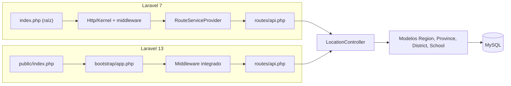

# Cambios de arquitectura: Bridges Note, de Laravel 7 a Laravel 13

**Autor:** Jhordy Antonio Salazar Ramos
**Curso:** Arquitectura de Software (UNAS)
**Fecha:** 15 de noviembre de 2026
**Repositorio:** https://github.com/larzyor/bridgesnote-laravel13
**Proyecto base:** https://github.com/hubelsolis/brigesnote.git

## 1. Objetivo

La migración de Bridges Note (API REST que sincroniza y sirve regiones, provincias, distritos y colegios del Perú desde la API de MINEDU/ESCALE) se plantea como **caso de estudio**: ver si al pasar de Laravel 7 (PHP 7.x) a Laravel 13 (PHP 8.3 o superior) cambia la arquitectura de la aplicación. Este documento resume lo observado, con la evidencia del repositorio.

## 2. Resumen

- **La arquitectura de la aplicación no cambió.** Sigue siendo una API en capas: rutas → controlador → modelos → base de datos, más un comando de consola que sincroniza los datos.
- **La arquitectura del framework sí cambió.** Laravel 13 reemplaza varias clases dispersas de arranque (kernels, providers, handler y middleware) por una configuración central en `bootstrap/app.php`.
- **El resultado práctico:** el repositorio del proyecto quedó más delgado en infraestructura y el código propio casi no se tocó.

## 3. Comparación

| Aspecto | Laravel 7 (original) | Laravel 13 (migrado) | Efecto |
|---|---|---|---|
| Versión de PHP | 7.2.5 o superior, README recomendaba 7.4 | 8.3 o superior (probado con 8.5.4) | Tipos de retorno y sintaxis de PHP 8 disponibles |
| Arranque de la app | `app/Http/Kernel.php`, `app/Console/Kernel.php` y providers | `bootstrap/app.php` con `Application::configure(...)` | Configuración en un solo lugar |
| Registro de rutas | `RouteServiceProvider` cargaba `routes/api.php` con prefijo `api` | `withRouting(api: ...)` en `bootstrap/app.php` | Una línea reemplaza a una clase |
| Providers | `AuthServiceProvider`, `BroadcastServiceProvider`, `EventServiceProvider`, `RouteServiceProvider` y `AppServiceProvider` | `bootstrap/providers.php` y solo `AppServiceProvider` | Menos clases que mantener |
| Middleware | 8 clases en `app/Http/Middleware/` (`TrustProxies`, `TrimStrings`, `EncryptCookies`, `VerifyCsrfToken`, etc.) | Integrados en el framework; se personalizan con `withMiddleware()` | El proyecto ya no copia código del framework |
| Manejo de errores | Clase `app/Exceptions/Handler.php` | `withExceptions()` en `bootstrap/app.php` (aquí, respuestas JSON para `api/*`) | Configuración declarativa |
| Comandos de consola | `app/Console/Kernel.php` registraba los comandos | Se detectan solos en `app/Console/Commands`; el resto va en `routes/console.php` | `SyncLocations` funciona sin registro manual |
| Punto de entrada web | `index.php` y `server.php` en la raíz del proyecto | `public/index.php` | Solo `public/` queda expuesto al servidor web |
| Autenticación de la API | Guard `api` con `auth:api` y ruta `/user` | Sin guard por defecto; la ruta `/user` se quitó por no usarse | API pública de solo lectura, sin cambios funcionales |
| Dependencias de infraestructura | `fideloper/proxy`, `fruitcake/laravel-cors` y `facade/ignition` | Ya no se declaran en `composer.json` (proxies y CORS vienen integrados) | Menos paquetes de terceros |
| Archivos de configuración | `cors.php`, `broadcasting.php`, `hashing.php`, `view.php`, etc. | Solo los necesarios; el resto usa valores por defecto del framework | Menos configuración que revisar |
| Frontend | Laravel Mix (`webpack.mix.js`) | Vite (`vite.config.js`) | No afecta a esta API, que no tiene interfaz |
| Migraciones | Clases con nombre (`class CreateXTable`) y tablas de usuarios, `password_resets` y `failed_jobs` sueltas | Migraciones anónimas (`return new class`) y tablas base (usuarios, cache, jobs) del nuevo esqueleto | Sin conflictos de nombres de clase |
| Seeders | `database/seeds` | `database/seeders` | Cambio de convención de carpeta |
| Pruebas | `tests/CreatesApplication.php` y base de datos real | Sin `CreatesApplication`; SQLite en memoria en `phpunit.xml` | Pruebas rápidas y aisladas |
| Archivos para servidor | `.htaccess` y `web.config` en la raíz | `.htaccess` dentro de `public/` | Configuración alineada con el nuevo punto de entrada |

## 4. Flujo de una petición



Desde `routes/api.php` hacia adelante, el recorrido es idéntico en las dos versiones. Lo que cambió es cómo llega la petición hasta ahí.

## 5. Lo que no cambió

- La estructura de capas: rutas, controlador (`LocationController`), modelos y base de datos.
- Los 4 endpoints y sus respuestas JSON (`status`, `data` y mensajes de error con 404).
- El comando `sync:locations` y su lógica de sincronización con la API de MINEDU/ESCALE.
- El esquema de las 4 tablas (`regions`, `provinces`, `districts`, `schools`).
- La responsabilidad de cada clase propia.

## 6. Cambios hechos en el código propio

| Cambio | Motivo |
|---|---|
| Consultas con `SUBSTR()` en lugar de `LEFT()` | Funcionan igual en MySQL y en SQLite (pruebas) |
| Se eliminó la ruta `/user` con `auth:api` | No se usaba y el guard `api` no existe en el nuevo esqueleto |
| Tipos de retorno y de parámetros (`: JsonResponse`, `: int`, `: void`, `string`) | Aprovechar PHP 8 |
| Se quitó el constructor vacío de `SyncLocations` y los `use HasFactory` sin usar | Limpieza |
| Migraciones anónimas | Convención actual de Laravel |
| Se agregaron 5 pruebas automáticas de los endpoints | Verificar que la migración no cambió el comportamiento |

## 7. Evidencia

- Plan escrito antes de ejecutar: [`PLAN_MIGRACION.md`](PLAN_MIGRACION.md).
- Pull Request #1 con 7 commits (uno por etapa).
- Tags: `laravel7-base` (estado inicial) y `laravel13-ok` (estado final).
- Verificación: `php artisan migrate:fresh` (7 migraciones), `php artisan test` (7 pruebas, 18 aserciones), `php artisan route:list --path=api` (4 rutas) y `php artisan sync:locations` con datos reales.

Para ver la diferencia completa entre las dos versiones:

```bash
git diff laravel7-base laravel13-ok --stat
```

## 8. Conclusiones

1. La migración cambia la **forma de arrancar y configurar** la aplicación, no su **diseño en capas**.
2. Laravel 13 es un framework más delgado: lo que antes eran clases del proyecto (kernels, middleware, handler y varios providers) ahora vive dentro del framework y se ajusta desde `bootstrap/app.php`.
3. Como Bridges Note guardaba su lógica de negocio en controlador, modelos y comando, la migración se limitó a trasladar ese código y hacer ajustes pequeños.
4. La separación de responsabilidades fue lo que hizo la migración sencilla: poco código propio acoplado al framework significó pocos cambios.
5. Subir versión por saltos (7 → 8 → … → 13) habría exigido varias versiones de PHP; partir de un esqueleto limpio fue la ruta más directa para un proyecto de este tamaño.

## 9. Uso de agentes de IA

La migración se hizo con apoyo de un asistente de IA, con autorización del docente. El detalle está en la sección "Uso de agentes de IA" del [`README.md`](README.md).

## 10. Correcciones posteriores a la migración

Una revisión posterior detectó dos puntos que la primera versión de este documento no recogía.

**Límite de peticiones (rate limiting).** En Laravel 7 el grupo `api` incluía `throttle:60,1` por defecto en `app/Http/Kernel.php`. En Laravel 13 ese grupo ya no lo trae activado, así que al migrar se perdió el límite de 60 peticiones por minuto sin ningún error visible. Se corrigió en `bootstrap/app.php` y se agregó una prueba que verifica que la petición 61 responde 429.

**Lección de arquitectura:** migrar el código propio no basta. Los grupos de middleware dejaron de vivir en `Kernel.php` y sus valores por defecto cambiaron, por lo que hay que revisar también los comportamientos que el framework daba por defecto.

**Versión de PHP.** El `composer.lock` generado con PHP 8.5 incluía componentes de Symfony 8, que exigen PHP 8.4 o superior, por lo que el proyecto no instalaba en PHP 8.3. Se fijó `config.platform.php = 8.3.0` en `composer.json` y se regeneró el lock. Con ello el proyecto funciona en PHP 8.3, 8.4 y 8.5; las 8 pruebas pasan en PHP 8.3.36 y en PHP 8.5.4.
